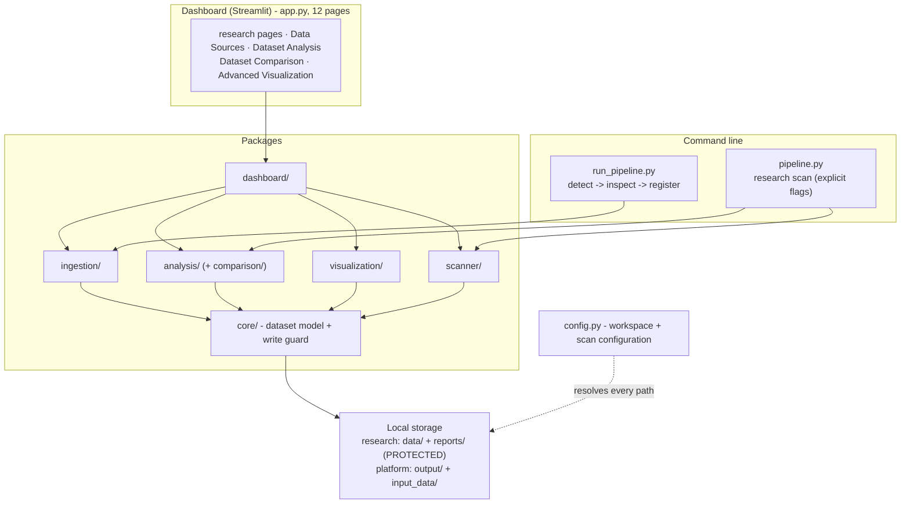
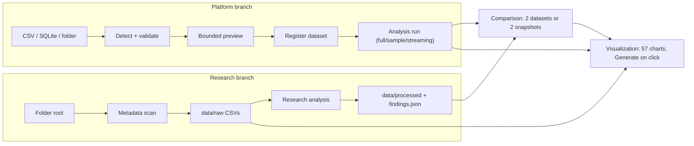

# Digital Archaeology

**Reusable local data analysis and visualization platform for Windows** —
understand the evolution of digital work through file-system metadata, and
profile, compare and chart your own datasets.

[](https://www.python.org/downloads/)
[](https://www.python.org/downloads/)
[](docs/PRIVACY_AND_DATA_PROTECTION.md)

All processing is **local**: metadata only (file contents are never read
by the scanner), no cloud upload, no telemetry, research data untouched.

---

## Table of contents

1. [Project overview](#1-project-overview)
2. [Problem statement](#2-problem-statement)
3. [Project objectives](#3-project-objectives)
4. [Key capabilities](#4-key-capabilities)
5. [Four operating modes](#5-four-operating-modes)
6. [Architecture overview](#6-architecture-overview)
7. [Data-processing workflow](#7-data-processing-workflow)
8. [Visualization capabilities](#8-visualization-capabilities)
9. [Technology stack](#9-technology-stack)
10. [Installation requirements](#10-installation-requirements)
11. [Windows installation](#11-windows-installation)
12. [Running the application](#12-running-the-application)
13. [Workspace configuration](#13-workspace-configuration)
14. [Privacy and local-data protection](#14-privacy-and-local-data-protection)
15. [Project folder structure](#15-project-folder-structure)
16. [Testing and verification](#16-testing-and-verification)
17. [Known limitations](#17-known-limitations)
18. [Future improvements](#18-future-improvements)
19. [Author and project information](#19-author-and-project-information)
20. [License](#20-license)

## 1. Project overview

Digital Archaeology is a Streamlit-based desktop application plus two
command-line tools that turn **metadata** into understanding:

- **Research mode** — scan a folder tree (metadata only) and explore how a
  digital collection grew: timelines, storage, file types, naming
  patterns, duplicates, folder structure and evidence-backed findings,
  with snapshot-to-snapshot comparison.
- **Reusable platform** — ingest your own CSV / SQLite / folder datasets,
  profile and analyze them with a streaming-capable analysis engine,
  compare two datasets or two snapshots, and build bounded, provenance-
  labelled charts from a 57-spec chart catalogue.

Everything runs on your machine. The project is developed and verified on
**Windows 11 with Python 3.11**.

## 2. Problem statement

Personal and research file collections grow for years without anyone
understanding *how*: when files were created, what consumes storage, which
naming conventions took over, what is duplicated, how the tree evolved
between two points in time. Answering those questions usually means either
uploading private metadata to unknown services or writing one-off scripts
that are hard to reuse.

Separately, analysts repeatedly need the same basics for **their own**
datasets — profile, quality check, statistics, distributions, comparison,
charts — often re-implemented per project.

## 3. Project objectives

1. Provide a **privacy-conscious** way to study file-system evolution
   through metadata — never file contents.
2. Grow the research dashboard into a **reusable local platform**: any
   CSV, SQLite database or folder metadata can be registered, analyzed,
   compared and visualized.
3. Make the whole application **portable**: installable on another
   Windows machine with three scripts, no hardcoded personal paths.
4. Keep **research data provably untouched** (SHA-256 integrity gate over
   22 protected files after every development phase).
5. Stay **honest**: every approximation, sampling cap or heuristic is
   disclosed on the figure, in the export and in the docs.

## 4. Key capabilities

- Metadata-only folder scanning with resume, exclusions and explicit
  drive-scan confirmation (`--yes`) — nothing scans automatically.
- Eight research dashboard pages over the historical scan, plus snapshot
  creation and snapshot comparison.
- Ingestion workflow for **CSV, SQLite and filesystem** sources:
  detect → validate → bounded preview → confirm → register (descriptors
  only, never row contents).
- Analysis engine with **full / sample / streaming** modes, statistics,
  missing values, duplicates, frequencies, distributions, correlation,
  outliers and data-quality reports — with the exactness basis disclosed.
- Comparison engine for **two datasets or two snapshots** (keys or no-key
  fallback; exact vs. approximate flagged in red).
- **57-chart visualization catalogue** (bar → t-SNE, hierarchical,
  3-D, run and comparison charts) with bounded reads, seeded sampling
  and HTML/CSV export bundles carrying full provenance.
- Portable workspace (`DIGITAL_ARCHAEOLOGY_HOME`), environment checker,
  and non-destructive Windows install/launch scripts.

## 5. Four operating modes

Full reference (inputs, processing, analyses, outputs, use cases,
limitations): **[docs/architecture/operating-modes.md](docs/architecture/operating-modes.md)**.

| # | Mode | Pages / entry points | What it does |
|---|---|---|---|
| 1 | **Mode A — Digital Archaeology (research)** | Overview, File Creation Timeline, Storage Analytics, File Type Analysis, Naming Pattern Analysis, Duplicate Analysis, Folder Structure, Research Findings + sidebar snapshot panel; CLI `pipeline.py` | Metadata scan of a folder tree and the full research analysis over it |
| 2 | **Mode B — General Dataset Analysis** | Data Sources (ingestion) + Dataset Analysis (engine); CLI `run_pipeline.py` | Register your CSV/SQLite/folder inputs, then profile and analyze them |
| 3 | **Comparison mode** | Dataset Comparison page + sidebar snapshot comparison | Quantify differences between two datasets or two snapshots |
| 4 | **Visualization mode** | Advanced Visualization (sections: Archaeology · Dataset · Comparison) | Chart workbench over the outputs of the other three modes |

Navigation note: the sidebar lists **five page groups** (Data Sources is
shown separately because it is the ingestion interface *shared* by modes
2–4), and the chart engine has **three internal chart sections**
(archaeology 15 · dataset 33 · comparison 9 = 57 specs). All taxonomies
are reconciled in the
[operating-modes document](docs/architecture/operating-modes.md).

## 6. Architecture overview



Diagrams A–E (architecture, data flow, modes, workspace, privacy
boundaries): **[docs/architecture/README.md](docs/architecture/README.md)**.
Folder-by-folder reference: **[docs/PROJECT_STRUCTURE.md](docs/PROJECT_STRUCTURE.md)**.

## 7. Data-processing workflow



- Research outputs stay under `data/` + `reports/` (**protected**).
- Platform outputs go to `output/` (registry, analysis runs, comparisons,
  chart exports) — safe to delete, never published.
- The research SQLite archive is built only by a manual utility; no code
  path recreates it implicitly.

Deep dive: [docs/architecture/data-ingestion-workflow.md](docs/architecture/data-ingestion-workflow.md).

## 8. Visualization capabilities

No screenshots exist yet (see [docs/assets/README.md](docs/assets/README.md)
for the capture list) — so here is the verified capability inventory
(`visualization/chart_registry.py`, 57 specs, 2026-11-23):

| Section (mode) | Charts | Examples |
|---|---|---|
| Archaeology (scan frames & snapshots) | 15 | timelines, storage mix, sunburst of the folder tree, snapshot deltas |
| Dataset (preview + analysis runs) | 33 | bar/line/area/pie, histogram/box/violin/density/ECDF, scatter/bubble/pair, correlation heatmap, missing-values matrix, PCA, t-SNE*, 3-D scatter, treemap/sunburst/icicle, run quality/outlier charts |
| Comparison (completed A-vs-B runs) | 9 | record-count deltas, per-column distribution shifts, schema drift |

Honesty rules baked into the engine: nothing renders before **Generate**;
row caps, sampling (seed 42) and top-N regrouping are always disclosed;
exports contain full provenance and no absolute paths; approximate
comparison charts are badged red.

\* t-SNE requires the optional `scikit-learn` package; PCA works without it.
User guides: [docs/VISUALIZATION_GUIDE.md](docs/VISUALIZATION_GUIDE.md),
[docs/COMPARISON_GUIDE.md](docs/COMPARISON_GUIDE.md),
[docs/DATA_INPUT_GUIDE.md](docs/DATA_INPUT_GUIDE.md).

## 9. Technology stack

| Layer | Choice |
|---|---|
| Language | Python 3.11+ (developed & tested with 3.11.9) |
| UI | Streamlit (layout: wide) |
| Dataframes | pandas, NumPy |
| Charts | Plotly (figures rendered locally; export inlines Plotly JS) |
| Storage | SQLite (read-only sources via `mode=ro`; registry + research archive) |
| Tests | pytest (development-only dependency) |
| Optional | scikit-learn (t-SNE only) |

Runtime dependencies are exactly the four lines of `requirements.txt`;
nothing else is required to install or run.

## 10. Installation requirements

- **Windows 10/11** (verified on Windows 11).
- **Python 3.11 or newer** — [python.org/downloads](https://www.python.org/downloads/)
  (tick *Add python.exe to PATH*).
- ~1 GB free disk space; internet access for the one-time dependency
  download.
- No admin rights required; no services, databases servers or Docker.

## 11. Windows installation

Open a Command Prompt **in the project folder**:

```bat
:: 1. Install (creates .venv only if missing; never touches data)
scripts\install_windows.bat

:: 2. Verify Python, dependencies, workspace and directories
scripts\check_environment.bat

:: 3. Launch -> http://localhost:8501
scripts\run_windows.bat
```

Full guide with manual steps, workspace variables, directory map,
common installation errors and troubleshooting:
**[docs/WINDOWS_INSTALL.md](docs/WINDOWS_INSTALL.md)**.

Optional (developers):

```bat
.venv\Scripts\python.exe -m pip install pytest
.venv\Scripts\python.exe -m pip install scikit-learn   :: only for t-SNE
```

## 12. Running the application

```bat
scripts\run_windows.bat
```

- Prints the project and active workspace, then opens
  `http://localhost:8501` in your browser; the terminal keeps the app
  output visible (`Ctrl+C` stops it).
- The launcher **never scans anything**.
- First run without scan data shows a first-time setup panel with the
  exact commands to run.

Research scan (explicit, metadata only):

```bat
.venv\Scripts\python.exe pipeline.py --scan --scan-root "C:\path\you\want\to\scan"
```

Your own dataset (no scan needed):

```bat
.venv\Scripts\python.exe run_pipeline.py --input "C:\data\myfile.csv"
```

then open the **Data Sources** page in the dashboard.

## 13. Workspace configuration

| Variable | Purpose | Default |
|---|---|---|
| `DIGITAL_ARCHAEOLOGY_HOME` | Workspace root where `data\`, `reports\`, `logs\`, `output\`, `input_data\` resolve | project folder (contains `app.py`) |
| `DA_SCAN_ROOT` | Default target of the research scan CLI | `D:\` (original research machine — always pass `--scan-root` elsewhere) |

```bat
set DIGITAL_ARCHAEOLOGY_HOME=D:\MyArchaeologyWorkspace
scripts\run_windows.bat
```

- The override **never moves, copies or deletes** existing data; missing
  directories are created safely (nothing overwritten, the research
  database is never recreated).
- If an override would hide existing research data, the sidebar shows an
  explicit warning — switching away from your data is never silent.
- The active workspace is always displayed in the sidebar.
- Nothing scans automatically; whole-drive scans additionally require
  `--yes`.

Diagram: [docs/architecture/workspace-configuration.md](docs/architecture/workspace-configuration.md).

## 14. Privacy and local-data protection

- **Metadata only** — the scanner never opens file contents; inputs are
  read-only (SQLite via `mode=ro`); the registry stores descriptors, not
  rows.
- **No network in application code** — no cloud, no telemetry, no APIs.
- **No automatic scans** — explicit CLI flags only; drive roots gated by
  `--yes`.
- **Research preserved** — protected paths guarded by
  `ProcessingContext` and re-verified by a 22-file SHA-256 integrity gate
  after every phase.
- **Private by default** — `data/`, `output/`, `logs/`, `backups/`,
  `reports/*` and `*.db` are gitignored (default-deny).

Full statement with the honest limitation list:
**[docs/PRIVACY_AND_DATA_PROTECTION.md](docs/PRIVACY_AND_DATA_PROTECTION.md)**
(short version: [docs/PRIVACY.md](docs/PRIVACY.md)).

## 15. Project folder structure

```text
Digital Archaeology/
├── app.py                  Streamlit dashboard (12 pages)
├── pipeline.py             Research scan CLI (explicit flags)
├── run_pipeline.py         Dataset detect/inspect/register CLI
├── config.py               Paths, workspace resolution, scan settings
├── requirements.txt        4 runtime dependencies
├── scripts/                install / check / run Windows helpers
├── dashboard/              12 page modules + shared helpers
├── scanner/                Metadata-only scanner, snapshots, duplicates
├── analysis/               Research modules, dataset engine, comparison/
├── ingestion/              Detector, validators, CSV/SQLite/folder loaders
├── core/                   Dataset model, exceptions, write guard
├── visualization/          57-chart registry, builders, export
├── tests/                  Full pytest suite (423 tests)
├── docs/                   Guides + architecture diagrams + assets
├── data/                   Research data — PROTECTED, never modified
├── reports/                Research outputs — PROTECTED (local only)
├── output/                 Platform outputs (gitignored, safe to delete)
├── input_data/             Your dataset drop zones
└── logs/                   Runtime log + scan resume state
```

Detailed map: [docs/PROJECT_STRUCTURE.md](docs/PROJECT_STRUCTURE.md).

## 16. Testing and verification

```bat
.venv\Scripts\python.exe -m pip install pytest
.venv\Scripts\python.exe -m pytest tests -q
```

`pytest` is development-only and intentionally not in `requirements.txt`.
All test data is synthetic and written to OS temporary directories; the
suite runs without any research data present.

**Verified results (Phase 10 publication verification, 2026-11-23):**

| Check | Result |
|---|---|
| Full test suite (Python 3.11.9, pandas 3.0.5) | **422 passed, 1 skipped, 0 failed** (423 collected) |
| Isolated clean install without research data or scikit-learn (Phase 8) | **420 passed, 3 skipped, 0 failed** |
| Protected-data integrity (read-only SHA-256 checker) | **22/22 files byte-identical, exit 0** |
| Documentation link check (17 public docs) | **31/31 links valid, 0 broken** |

Skips are explained in the test suite (OS forbids symlink creation in one
test; two t-SNE tests skip when the optional scikit-learn is absent).
Portability is covered by 18 tests for 17 scenarios (spaces, Unicode
paths, foreign working directory, missing dependencies, protected-data
non-writes — see `tests/test_portability.py`).

## 17. Known limitations

- Verified on **one Windows 11 machine**; other Windows versions and
  physical machines are untested.
- Paths longer than the legacy 260-character limit are recorded as
  per-path scan errors, not retried with extended-length syntax.
- t-SNE needs optional scikit-learn; PCA and everything else work without
  it.
- The default scan target `D:\` reflects the original research machine —
  always pass `--scan-root` on other computers.
- Analysis modes labelled *sample* / *streaming* are approximations and
  say so; comparison exports are bounded and disclose their caps.
- CSV/SQLite/filesystem inputs only (no Parquet yet); single-user local
  app (no auth, no multi-user isolation).
- No CI, no automated browser tests (UI checks use Streamlit's `AppTest`),
  no screenshots yet.
- This is not an external security audit; see the privacy document's
  limitation list.

## 18. Future improvements

Candidates drawn from the project's own audit documents — not
commitments: pinned/reproducible dependency sets, a CI workflow once the
repository is tracked, screenshot assets, extended-length (long) path
support, Parquet input support, richer chart coverage, and optional
desktop packaging (PySide6).

## 19. Author and project information

- **Project:** Digital Archaeology — Reusable Local Data Analysis and
  Visualization Platform (academic Data Visualization project).
- **Repository:** <https://github.com/ArulAgnes/DIGITAL_ARCHAEOLOGY>
- **Developed on:** Windows 11 · Python 3.11.9 · Streamlit · pandas ·
  Plotly · SQLite.
- **Phases 0–10** were completed under a phase-gated process with test
  reports and protected-data integrity checks after every phase; phase
  reports live locally in `reports/` (not published).

## 20. License

This project is licensed under the MIT License — see
[LICENSE](LICENSE) for the full text.

```text
MIT License · Copyright (c) 2026 Arul Maria Agnes
```
