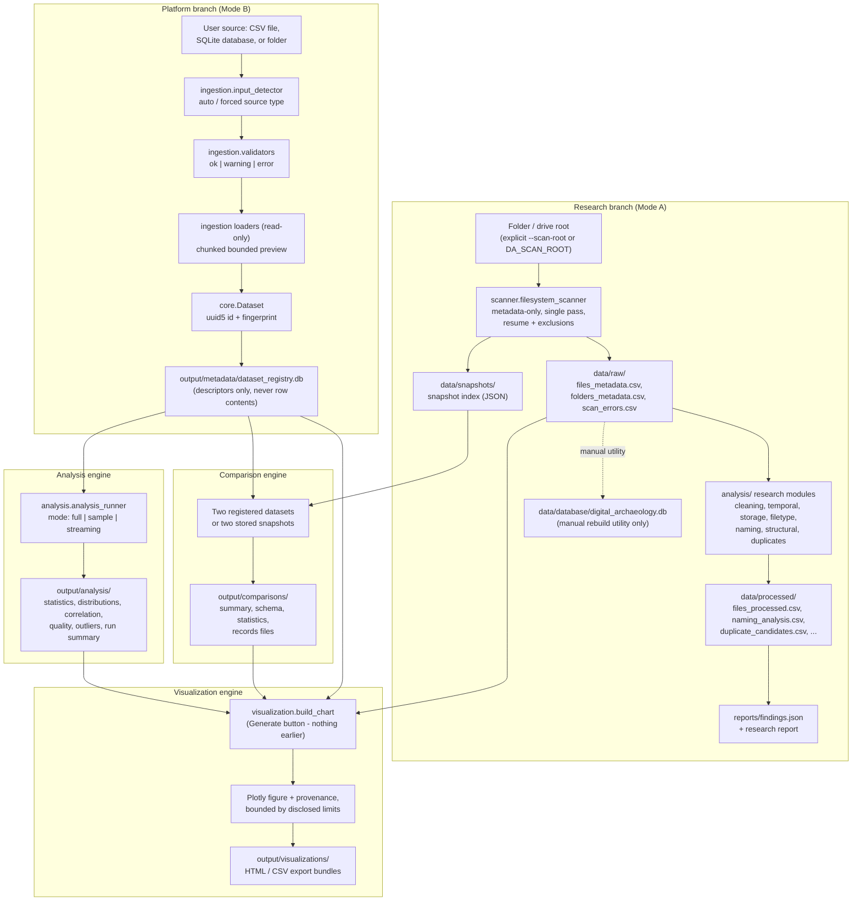

# Diagram B — Data ingestion and analysis workflow

Two branches share the same packages: the **research branch** (Mode A,
metadata scan of a folder tree) and the **platform branch** (Mode B,
user-supplied datasets). Both are local and read-only towards their
sources.

Safety facts reflected in the diagram (verified in code):

- Every source opens **read-only** (CSV with bounded `nrows`/`usecols`;
  SQLite via `file:...?mode=ro`).
- Nothing runs until an explicit button/CLI flag; no implicit scans.
- Analysis and comparison outputs go exclusively under `output/`;
  research outputs stay under the protected `data/` + `reports/` trees.
- Chart generation is bounded (`VisualizationConfig` clamps) and
  discloses sampling/caps on the figure and in exports.
