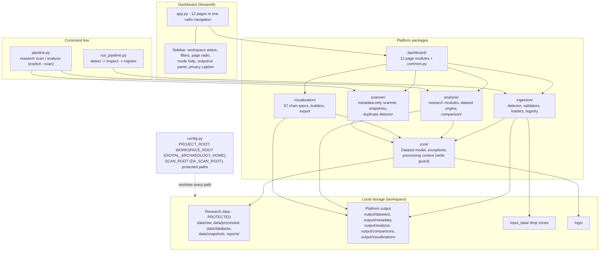

# Diagram A — High-level architecture

Notes (verified 2026-11-23):

- Single-process, fully local: no service, queue, API server or cloud
  component exists in the codebase.
- `core.processing_context.ProcessingContext` enforces the protected-path
  write guard used by every platform writer.
- The research SQLite archive under `data/database/` is protected and is
  never written by application or CLI code; rebuilding it from CSVs was a
  one-off manual research operation whose utility is deliberately
  excluded from the public repository (dangerous, machine-specific).
