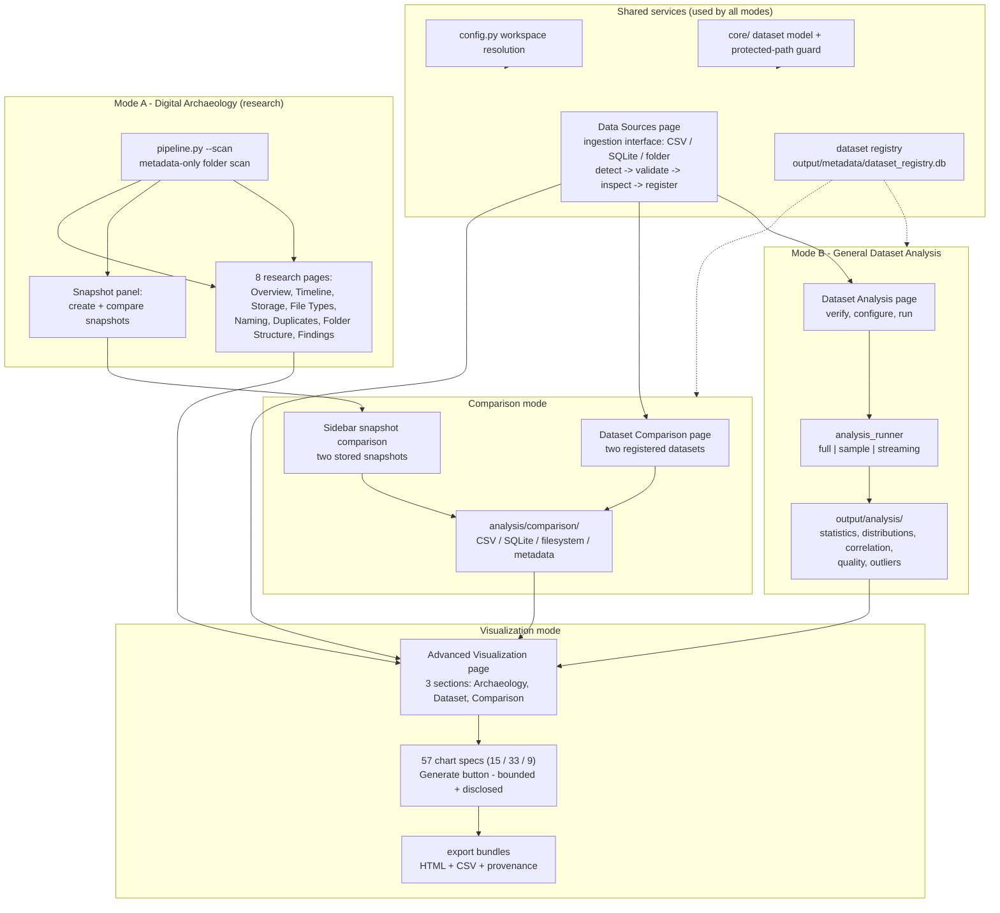

# Diagram C — The four operating modes and their relationships

## The four modes

The platform has **four operating modes**, identified from the actual
implementation (page wiring in `app.py`, engines under `analysis/` and
`visualization/`, and the two CLI entry points):

1. **Mode A — Digital Archaeology (research)**
2. **Mode B — General Dataset Analysis**
3. **Comparison mode** (datasets or snapshots)
4. **Visualization mode** (chart workbench)

### Taxonomy reconciliation (important)

Three different “mode” vocabularies exist in the project’s history; this
document is the canonical one for presentation:

| Vocabulary | What it counts | Where |
|---|---|---|
| Master roadmap | 2 modes: **A** (research) and **B** (general datasets) | original project instructions; code comments |
| Sidebar navigation | **5 page groups**: Digital Archaeology, Data Sources, Dataset Analysis, Dataset Comparison, Advanced Visualization | `app.py::_sidebar_modes` |
| Chart registry | **3 chart sections**: `archaeology` (15), `dataset` (33), `comparison` (9) = 57 specs | `visualization/chart_registry.py` |
| **Canonical (this document)** | **4 operating modes** | derived from end-to-end workflows |

**Data Sources is the ingestion interface shared by modes 2–4**, which is
why the sidebar lists it as its own group while Mode B’s workflow includes
it. The three chart sections are the *Visualization mode’s* internal
sections, not separate operating modes.

---

## Mode reference (purpose, inputs, processing, analyses, visualizations, outputs, use cases, limitations)

### 1. Mode A — Digital Archaeology (research)

| Aspect | Detail |
|---|---|
| **Purpose** | Understand the evolution of digital work through file-system metadata of a folder tree (the original research use case). |
| **Input data** | A folder/drive root, scanned explicitly via `pipeline.py --scan [--scan-root PATH]` (drive roots additionally need `--yes`). Reads **metadata only** — name, size, timestamps, path — never file contents. |
| **Processing** | Single-pass `scanner.filesystem_scanner` with exclusions, resume, bounded batches → `data/raw/*.csv`; research `analysis/` modules → `data/processed/*.csv`; findings → `reports/findings.json`; snapshots → `data/snapshots/`. |
| **Available analysis** | File-type/extension mix, size & storage distribution, creation/modification timelines, naming-pattern statistics, duplicate candidates (optional SHA-256 verification), folder depth/structure, cross-snapshot change metrics. |
| **Available visualizations** | 8 research pages (charts per page) + the Archaeology section of Advanced Visualization (15 chart specs over scan frames and stored snapshots). |
| **Output / reports** | Protected research tree: `data/raw`, `data/processed`, `reports/findings.json`, `reports/research_report.md`, snapshot index. |
| **Appropriate use cases** | Reproducible historical study of how a file collection grew; snapshot-to-snapshot change analysis; academic reporting over metadata. |
| **Limitations** | Metadata only (no content semantics); timestamps are whatever the filesystem reports; duplicate candidates are heuristics unless hash verification is enabled; whole-drive scans require explicit confirmation; long paths (>260 chars) are recorded as per-path errors. |

### 2. Mode B — General Dataset Analysis

| Aspect | Detail |
|---|---|
| **Purpose** | Load and analyze *your own* datasets — the reusable-platform core. |
| **Input data** | CSV files, SQLite databases (tables), or folder trees (filesystem metadata), via the **Data Sources** page or `run_pipeline.py --input PATH`. Drop zones: `input_data/csv`, `input_data/databases`, `input_data/metadata`. |
| **Processing** | `detect → validate → load_metadata (chunked, bounded) → Dataset (uuid5 + fingerprint) → register`. Registration stores **descriptors only** — never row contents. |
| **Available analysis** | Dataset profile (shape, memory, column kinds), per-column descriptive statistics, missing values, duplicate records, frequency/categorical analysis, numerical distributions, correlation matrices, IQR outliers, data-quality classification; runs are `full`, `sample` or `streaming` with the basis disclosed. |
| **Available visualizations** | Dataset Analysis page result views + the Dataset section of Advanced Visualization (33 chart specs: 26 preview charts + 7 analysis-run charts). |
| **Output / reports** | `output/metadata/` (registry, inspection JSON), `output/analysis/` (run summaries, CSV/JSON artifacts). |
| **Appropriate use cases** | Profiling a new CSV before trusting it; quality reports; exploratory statistics on medium/large local datasets. |
| **Limitations** | Approximate modes are labelled as such (sampling/reservoirs); filesystem folder inputs are metadata-only; Parquet and other formats are not supported yet; analysis runs re-verify sources read-only and never modify them. |

### 3. Comparison mode

| Aspect | Detail |
|---|---|
| **Purpose** | Quantify differences between **two datasets** or **two historical snapshots**. |
| **Input data** | Two registered datasets (CSV/SQLite/filesystem kinds) from the registry, or two valid snapshots from `data/snapshots/`; configured keys or no-key fallback strategies. |
| **Processing** | `analysis/comparison/` — validation of keys, read-only joins/matching, schema comparison, record-level diffs (bounded exports), exactness/strategy recorded per run. |
| **Available analysis** | Row-count and storage deltas, new/removed/modified records, per-column statistics comparisons, schema drift, warning lists. |
| **Available visualizations** | Dataset Comparison page views + the Comparison section of Advanced Visualization (9 chart specs over completed comparison runs). |
| **Output / reports** | `output/comparisons/` — summary, schema, statistics and records files with provenance. |
| **Appropriate use cases** | Before/after dataset changes; snapshot drift monitoring; validating an import against its source. |
| **Limitations** | Needs two comparable inputs (keys or compatible rows); bounded exports disclose caps; filesystem comparisons are metadata-only; snapshot comparison excludes snapshots marked invalid; anything not `exact` is flagged approximate in red. |

### 4. Visualization mode

| Aspect | Detail |
|---|---|
| **Purpose** | A single chart workbench over any data the platform already holds. |
| **Input data** | Three sections: **Archaeology** (scan frames + snapshots), **Dataset** (registered dataset previews or completed analysis runs), **Comparison** (completed comparison runs). |
| **Processing** | Nothing until **Generate** is pressed: role/kind validation without loading data, then a bounded read-only load, seeded sampling (seed 42), Plotly figure assembly with provenance badges. |
| **Available analysis** | Not an analysis mode per se — it *visualizes* research frames, dataset previews, analysis-run outputs and comparison results (57 chart specs across basic, statistical, multivariate, hierarchical categories). |
| **Available visualizations** | Bar/line/area/pie, histogram/box/violin/density/ECDF, scatter/bubble/pair/correlation heatmap, PCA & t-SNE (t-SNE needs optional scikit-learn), 3-D scatter, treemap/sunburst/icicle, run charts, comparison charts. |
| **Output / reports** | `output/visualizations/` — HTML + CSV export bundles with the full configuration and provenance; no absolute paths in exports. |
| **Appropriate use cases** | Presentation-ready charts from any registered data; comparing distributions visually; exporting figures for reports. |
| **Limitations** | Row caps and top-N regrouping are disclosed (never silent); preview charts are bounded (100k-row preview default); filesystem previews are refused (use the Archaeology section); t-SNE requires the optional scikit-learn package; nothing is computed on page load. |

### Relationships between modes

- **B, Comparison and Visualization all consume Data Sources registrations**
  (shared ingestion, one registry).
- **Comparison also consumes Mode A snapshots** (the sidebar snapshot panel
  creates them; only valid snapshots are comparable).
- **Visualization renders outputs of all three other modes** (its three
  sections map 1:1 to research frames, dataset runs, comparison runs).
- **Modes never mix storage:** research stays under `data/` + `reports/`
  (protected), platform work stays under `output/` + `input_data/`.
- **Shared safety core:** every mode goes through `core` (Dataset model,
  exceptions, `ProcessingContext` protected-path guard) and `config.py`
  workspace resolution.
