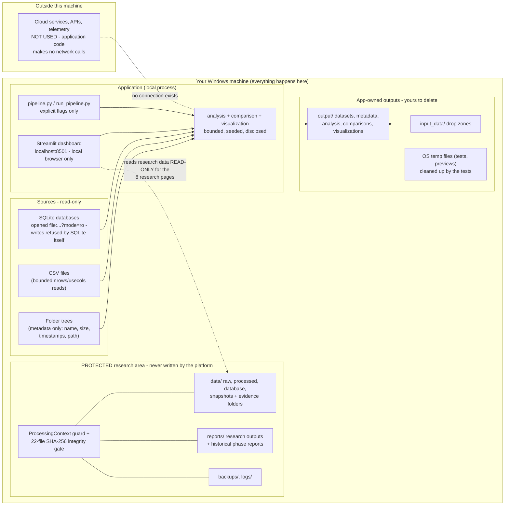

# Diagram E — Data privacy and local-processing boundaries

Boundary rules (from code inspection, 2026-11-23):

1. **Local processing only** — no network, telemetry, cloud upload or
   model/API calls with user data anywhere in the application code.
   (The one network operation in the project is `pip install` during
   setup, which downloads packages — never data.)
2. **No automatic full-drive scan** — `pipeline.py` without flags prints
   usage; drive roots need `--yes`; the dashboard never scans.
3. **Metadata only for folders** — file contents are never opened by the
   scanner; input files are never executed or imported.
4. **Read-only inputs** — CSVs read with bounds; SQLite opened with
   `mode=ro` so writes are refused at the engine level.
5. **Research preservation** — protected trees are guarded by
   `ProcessingContext` and re-verified with the 22-file integrity gate.
6. **Registry stores descriptors, not contents** — row data never enters
   `dataset_registry.db`.
7. **Error redaction** — user-facing errors print file names only;
   absolute paths stay in local logs.

Full details: [../PRIVACY_AND_DATA_PROTECTION.md](../PRIVACY_AND_DATA_PROTECTION.md).
