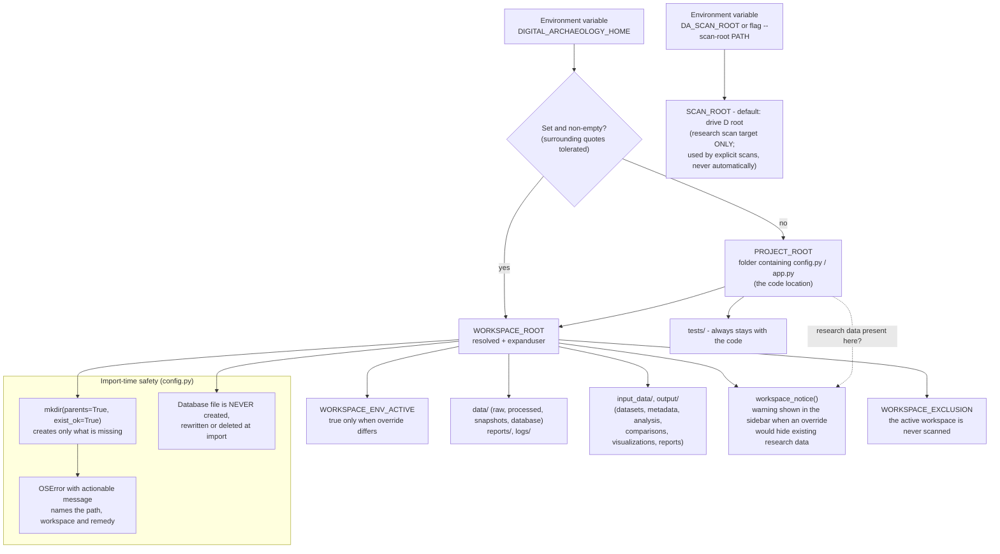

# Diagram D — Workspace and configuration flow

Rules (verified in `config.py`, 2026-11-23):

- **Default (variable unset):** `WORKSPACE_ROOT == PROJECT_ROOT` — behavior
  is byte-identical to Phases 0–7.
- The override **never** moves, copies or deletes anything; it only
  re-resolves where the application looks.
- If the override points at an empty workspace while research data exists
  under the project root, the sidebar shows an explicit warning — the
  application never silently switches away from existing data.
- `SCAN_ROOT` is a *scan target*, not the workspace: it only matters when
  you run an explicit scan, and drive roots additionally require `--yes`.

See also: [../WINDOWS_INSTALL.md](../WINDOWS_INSTALL.md) §4 (how to set the
variables) and [../PRIVACY_AND_DATA_PROTECTION.md](../PRIVACY_AND_DATA_PROTECTION.md).
